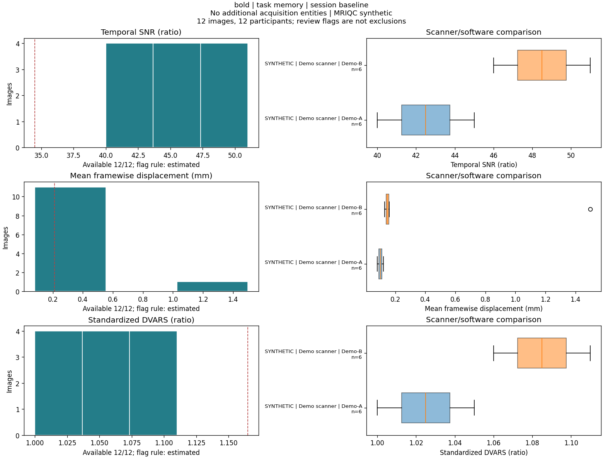

# TUBRIC QA

**Portable, review-first QC reports for BIDS datasets and MRIQC.**

Generate the cohort histograms, scanner/software comparisons and image-level
tables used in our RF1 work without requiring RF1 directory conventions,
fMRIPrep, TEDANA, a particular scanner, or specific task names. Runs, sessions,
acquisitions and echoes are kept distinct. The package never excludes a
participant or changes an image.



*The preview is fabricated demo data, not participant data or scientific results.*

## Quick Start

Use Python 3.10 or newer on Linux/macOS. **You need raw BIDS data and existing
MRIQC IQM JSONs. This command only builds a report; it never runs MRIQC,
preprocessing, or smoothing.** No Docker, Apptainer, AFNI, FSL or TEDANA is needed.

```bash
git clone https://github.com/DVS-Lab/tubric-qa.git
cd tubric-qa
python3 -m venv .venv
source .venv/bin/activate
python -m pip install .

tubric-qa build \
  --bids /path/to/bids \
  --mriqc /path/to/mriqc \
  --output /path/to/qc-report
tubric-qa check /path/to/qc-report --inputs
```

Open `/path/to/qc-report/index.html` in a browser. It is a self-contained folder
of local HTML, PNGs and tables; no server, login, telemetry, external JavaScript
or internet connection is needed to view it. Share the folder, not only HTML.
**Review its identifiers and local paths before sharing. It is not anonymized.**

To report one task and session, use a **new** output directory:

```bash
tubric-qa build --bids /path/to/bids --mriqc /path/to/mriqc \
  --task socialdoors --session 01 --output /path/to/qc-socialdoors-ses01
tubric-qa check /path/to/qc-socialdoors-ses01 --inputs
```

Use your dataset's exact labels. Repeat `--task` or `--session` for multiple
values. Values within each filter are ORed; task and session filters are ANDed.
`--task` selects functional images only, not anatomy. With no filters, all
BOLD/T1w/T2w images are included. All subjects, runs, echoes and parts within
the selection remain visible; there is no implicit participant exclusion.
Filters are saved in the report and reused by `check --inputs`.

### Progress And Runtime

Build prints elapsed time and stages immediately, with a heartbeat every 30
seconds during longer operations. `--quiet` suppresses those updates. A
heartbeat means the process is alive, not that a particular I/O call has finished.
The final output directory appears only after successful validation; temporary
files are built alongside it so incomplete reports are not mistaken for finished ones.

This is much less work than MRIQC, but not just reading JSONs: PyBIDS first
indexes filenames in the supplied BIDS root, then we read selected image headers,
resolve scanner metadata, match existing IQMs, fingerprint inputs and render PNGs.
Task/session filters reduce header reads and plotting, not the initial whole-root
indexing. Shared/network storage, the number of images/echoes and figure groups
can dominate runtime. There is no reliable cohort runtime estimate yet; use the
elapsed stage messages rather than assuming silence means MRIQC is running.
The first plot in a new environment may also take longer while Matplotlib
builds its font cache; its cache directory must be writable.
We do **not** build PyBIDS's full metadata database. A per-build cached JSON
reader resolves the three scanner fields from applicable ancestor sidecars,
using PyBIDS entity parsing and BIDS inheritance rules. Multiple applicable
sidecars at the same directory level are flagged as ambiguous, not resolved by
filename order. Directory/filename discovery still traverses the raw BIDS root.
`check --inputs` verifies fingerprints and inventories filenames without
resolving scanner metadata again or rereading NIfTI headers. It
also prints progress and heartbeats (`--quiet` is available).
Avoid `--hash-images` unless you need full image-content hashes: the default uses
image size/mtime and does not load image voxel arrays.

Record the commit and `python -m pip freeze` for your study; report provenance
also records core dependency versions. For the pinned **Python 3.13** reference
environment instead of independently resolved dependencies:

```bash
python3.13 -m venv .venv-reference
source .venv-reference/bin/activate
python -m pip install -r requirements-lock.txt
python -m pip install --no-build-isolation --no-deps -e .
```

Do not use that pinned reference lock with a different Python version. If
installation fails, retain the original error and report `python --version`
and `python -m pip --version`; no repository changes are normally needed.

### Linux: Missing `ensurepip` Or Broken `venv`

If `python3 -m venv` fails because `ensurepip` is unavailable, Python could not
bootstrap pip into the environment. This happens before TUBRIC QA is installed;
it is not evidence of incompatible package dependencies. Ask your administrator
for the matching Python venv support, or use Conda with its own Python and pip.
Do not install into Conda's shared `base` environment or use `sudo pip`.

From the cloned `tubric-qa` repository, this is an alternative to `venv`, not an
additional environment to activate inside it:

```bash
conda create -n tubric-qa python=3.13 pip -y
conda activate tubric-qa
python -m pip install -r requirements-lock.txt
python -m pip install --no-build-isolation --no-deps -e .
python -m pip check
tubric-qa --version
```

If the named Conda environment already exists, activate it rather than creating
it again. No source-code changes are needed for this workaround. After successful
installation, run the synthetic demo below before starting a large cohort.
See Python's [`ensurepip` documentation](https://docs.python.org/3.13/library/ensurepip.html).

## What You Get

| Output | Purpose |
|---|---|
| `index.html`, `figures/*.png` | Offline cohort report, histograms and scanner/software boxplots |
| `run_qc.tsv` | One row per raw BOLD/T1w/T2w image, matching status and metric values |
| `flags.tsv` | Per-image, per-metric review flags with explicit missing/unevaluated states |
| `thresholds.tsv` | Group sizes, quartiles and review fences |
| `scanner_summary.tsv` | Scanner-group medians, quartiles, upper tails and missingness |
| `orphan_mriqc.tsv` | MRIQC JSONs with no exact raw-image match |
| `config.json`, `methods.md` | Exact rules and methodological description |
| `provenance.json`, `validation.json` | Versions, code/input/output fingerprints and completeness |

Default functional metrics: **tSNR, mean FD, standardized DVARS, MRIQC FWHM,
EFC and FBER**. Structural T1w/T2w reports include FWHM, EFC, FBER, CNR and CJV.
TEDANA, brain coverage and other metrics can be added through an explicit,
exact-image-keyed table and metric configuration; they are not required.

## Rules That Prevent Silent Cohort Loss

- Flags are **not exclusion decisions**. No selected-subject list is generated.
- Fences use linear quartiles and 1.5 IQR, in a **single parallel pass**. A flag
  for one metric does not remove a row before another metric is evaluated.
- Thresholds never cross task/session, acquisition, direction, reconstruction,
  echo, part, modality or MRIQC-version boundaries. Optional scanner grouping
  is explicit. Runs are not pooled across sessions, nor collapsed per subject.
- Fewer than five values or zero IQR means **not classified**, not a pass.
- Smoothness is descriptive by default, not a "high is bad" rule.
- Missing/invalid metrics remain `n/a`, not zero or FALSE. Ambiguous source
  matches stop metric association instead of selecting an arbitrary file.
- All echoes are inventoried separately. If MRIQC only processed one echo,
  others are reported missing. They are not assigned that echo's IQMs.
- Source images are read only. Output directories must be new and separate
  from inputs; there is no overwrite flag. Your shell's umask is honored.

These defaults are starting points for review, not universal clinical or
scientific acceptance thresholds. Small, heterogeneous groups and repeated
runs require care. See [methods and interpretation](docs/methods.md).

## Try It Without Study Data

```bash
tubric-qa demo demo-data
tubric-qa build --bids demo-data/bids --mriqc demo-data/mriqc --output reports/demo
tubric-qa check reports/demo --inputs
```

The deterministic demo contains two tasks, two sessions, two fictional software
versions, an extreme motion value and one deliberately missing MRIQC JSON.
The latter is supposed to be reported. `--strict` returns exit 2 for that
incompleteness while still producing the report.

## Missing MRIQC Results

Missing results are listed in the report; `build` never computes them. To fill
gaps, run MRIQC separately using your institution's workflow. An optional,
advanced [MRIQC launcher](docs/mriqc.md) remains available for users who need it,
but it is not part of report generation and never executes without `--execute`.
The report's task/session filters do not configure that separate launcher.

You can supply multiple `--mriqc` roots. The first root with an exact match wins;
shadowed candidates are counted. Duplicates within a root remain ambiguous, and
an invalid primary match is not silently replaced with a fallback.

## Configuration And Optional Metrics

```bash
tubric-qa config > study-qc.json
# Edit this generated configuration, then:
tubric-qa build --bids /path/to/bids --mriqc /path/to/mriqc \
  --config study-qc.json --output /path/to/configured-report
```

Software labels use full inherited BIDS `SoftwareVersions` values by default.
The `software_labels` mapping allows explicit exact-string aliases such as a
study's scanner eras. No dates or vendor-specific codes are guessed. Consult
[configuration and optional metrics](docs/configuration.md) for TEDANA and
coverage examples.

## Reproducibility And Limitations

`check` verifies every report artifact against its manifest; `check --inputs`
also verifies source fingerprints and detects newly added BIDS/MRIQC files.
Metadata and IQMs receive full SHA256 hashes. Images use size/mtime by default
to avoid reading entire cohorts; add `build --hash-images` for full hashes.
These are integrity checks, not a cryptographic signature or scientific approval.

Currently supports **BOLD, T1w and T2w**. It does not run preprocessing, smooth
images, infer event validity, calculate template coverage without supplied
metrics, diagnose registration failures, or support diffusion/PET/EEG QC.
PyBIDS indexing is not a full BIDS validation. Run the official BIDS validator
and inspect MRIQC's individual visual reports as well. A numeric cohort plot
cannot substitute for those checks.

Exit codes: **0** report/check completed, **1** operational or integrity error,
**2** core input incompleteness with `--strict`. QC outlier flags alone never
cause a failure exit. MRIQC execution returns MRIQC's process status.

## Development

```bash
python -m pytest -q
python -m ruff check src tests
python -m build --no-isolation
```

Tests use synthetic data and mocked MRIQC launchers; no participant data are
included. The local test suite does not establish end-to-end MRIQC container
performance on every platform. CI runs the package tests and builds artifacts.

MIT licensed. Developed by the Temple University Neuroeconomics Lab, with
design lessons from `rf1-sra-linux2`. No RF1 participant data, paths, eligibility
rules or task-specific mappings are bundled. Please cite
[MRIQC](https://doi.org/10.1371/journal.pone.0184661) and the tools that produced
your metrics, and report the TUBRIC QA commit/configuration used.
